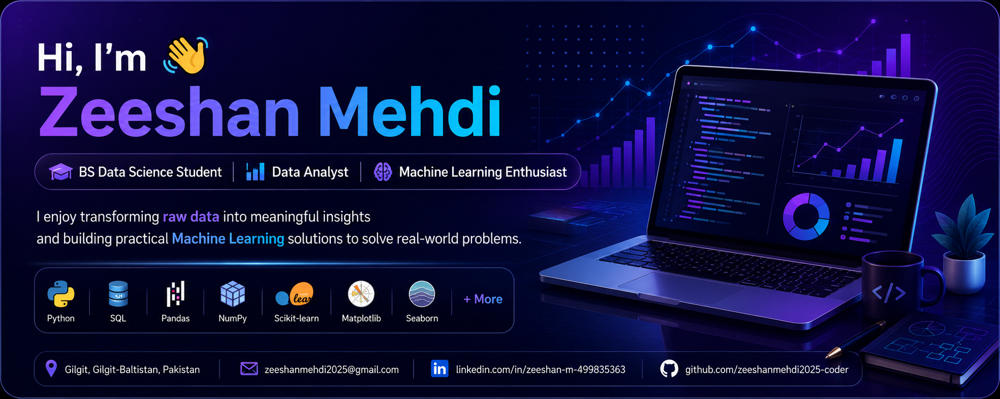

# Hi, I'm Zeeshan Mehdi 👋

### 🎓 Data Science Student | 📊 Aspiring Data Analyst | 🤖 Machine Learning Enthusiast

Welcome to my GitHub profile!

I'm a Data Science student who enjoys working with data, building machine learning models, and solving real-world problems using Python.

- 🔭 I'm working on Data Science and Machine Learning projects.
- 🌱 I'm learning Data Analytics, AI, and Model Deployment.
- 📊 I enjoy data cleaning, visualization, and predictive modeling.
- 🎯 My goal is to become a professional Data Scientist.

### 🌐 Connect With Me

- 💼 [LinkedIn](https://www.linkedin.com/in/zeeshan-m-499835363)
- 🌍 [My Portfolio](https://zeeshanmehdi2025-coder.github.io/zeeshan-portfolio/)
- 💻 [My GitHub Repositories](https://github.com/zeeshanmehdi2025-coder)
- 📧 Email: zeeshanmehdi2025@gmail.com

---

### 🛠️ Technologies & Tools

---

### 📊 My GitHub Statistics

---

### 🚀 Featured Projects

- 🌍 **World Happiness Analysis** — Analyzed global happiness data using Python, Pandas, and data visualization to explore key factors influencing happiness and uncover meaningful insights.
- 🏠 **House Price Prediction** — Built a machine learning project to predict house prices using Python and regression techniques.
- 🤖 **Resume Analyzer** — Developed a resume analysis tool to extract relevant skills and compare resumes with job descriptions.
- 📈 **Data Science Projects** — Explore my [GitHub repositories](https://github.com/zeeshanmehdi2025-coder?tab=repositories) to discover more projects in data analysis, machine learning, and Python.
---

### 📚 Currently Learning

- Machine Learning
- Deep Learning
- Advanced SQL
- Data Visualization
- Model Deployment

---

⭐ Thanks for visiting my profile!

*Turning data into insights, one project at a time.*

  

  

### Contribution graph

<h2 align="center">📊 My GitHub Contributions</h2>

  

